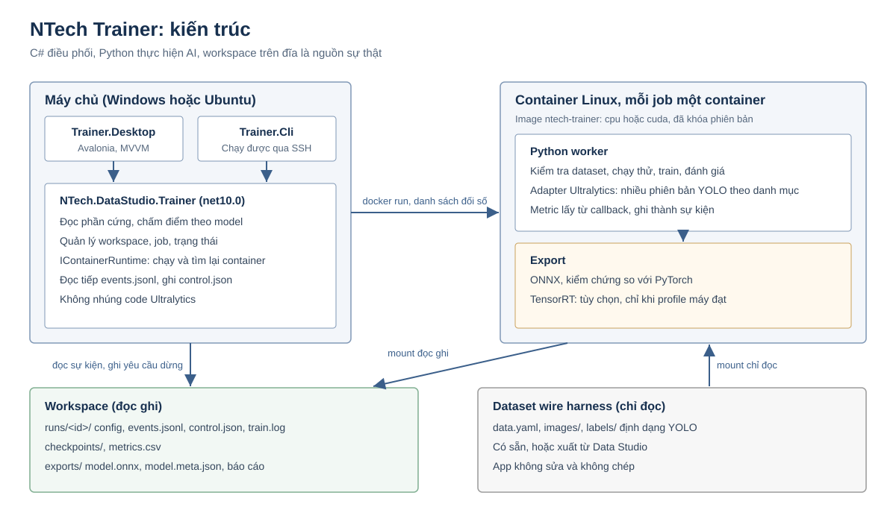
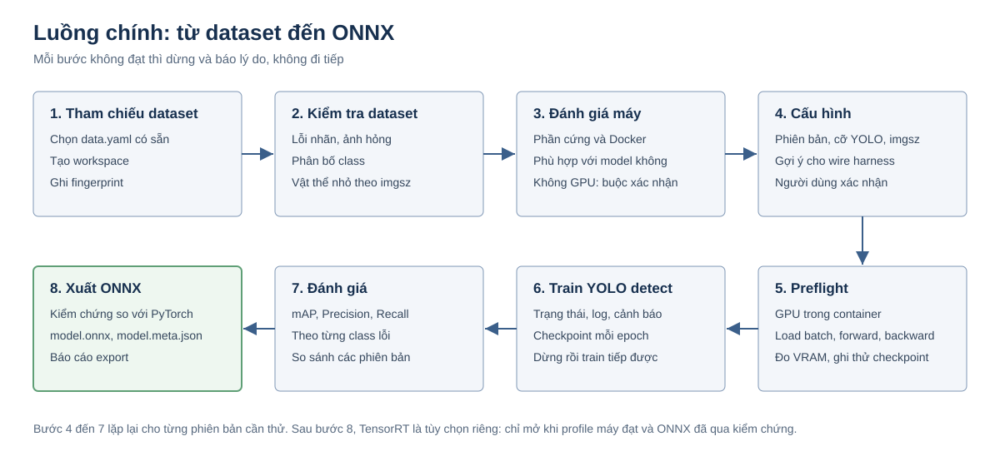
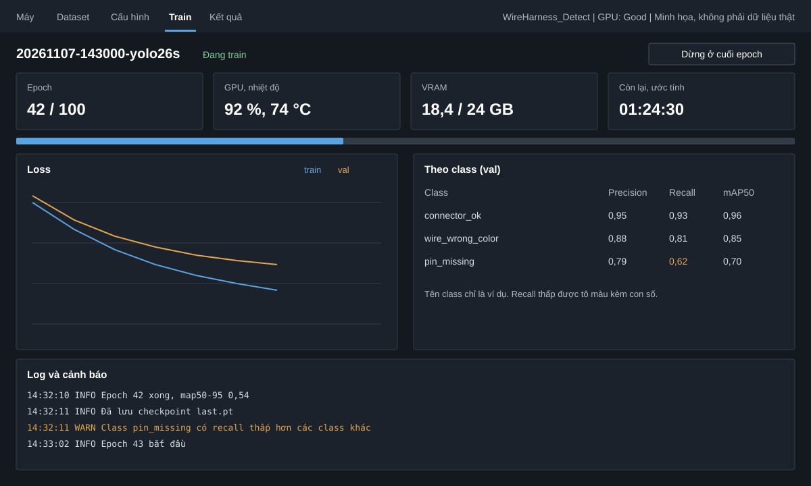
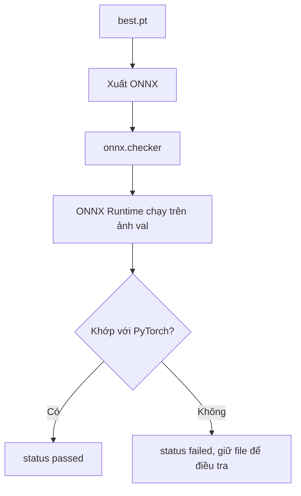

# NTech Trainer: System Design

| Thuộc tính | Giá trị |
| --- | --- |
| Sản phẩm | NTech Data Studio |
| Thành phần | NTech Trainer |
| Phiên bản | 0.4, đã có CLI và worker chạy được, chưa có Desktop |
| Ngày | 2026-11-08 |
| Thay cho | Initial System Design v0.1, các bản 0.2 và 0.3 |
| Máy train | Linux hoặc Windows cấu hình cao, GPU NVIDIA |
| Máy phát triển | Máy hiện tại, không dùng để train thật |
| Công nghệ | Avalonia, C# .NET 10, Python, PyTorch, Docker, ONNX |

**Mục tiêu trước mắt:** chạy được một luồng hoàn chỉnh.

> Dataset đã có (kiểm tra wire harness) → chọn phiên bản YOLO, train detect → xuất ONNX đã kiểm chứng.

Luồng phải train được **nhiều phiên bản YOLO**, không gắn cứng vào một phiên bản (mục 5). Mọi thứ không phục vụ luồng này đều để sau.

**Trạng thái:** luồng đã chạy thật bằng CLI trên image CPU với dataset tổng hợp, vì nhãn thật chưa xong (mục 13). Chưa chạy trên GPU và chưa chạy trên dataset thật. Cách dùng ở `trainer/README.md`.

## 1. Thay đổi so với v0.1

| Mục | v0.1 | Bản này | Lý do |
| --- | --- | --- | --- |
| Phạm vi MVP | Classification, Detection, OCR | YOLO detect, nhiều phiên bản (YOLO26, YOLO11, YOLOv8 trước) | Yêu cầu của chủ dự án |
| OCR | MVP | Để sau | Chưa phải trọng tâm; Data Studio cũng chưa gán được nhãn văn bản |
| TensorRT | Tiêu chí MVP | Tùy chọn, chỉ mở khi profile máy đạt | Yêu cầu của chủ dự án |
| Vai trò máy | Không phân biệt | Tách máy phát triển và máy train | Yêu cầu của chủ dự án |
| Đầu vào | Import vào project mới | Tham chiếu dataset YOLO có sẵn, không sửa, không chép | Dataset đã có; Data Studio chưa nhập được nhãn có sẵn |
| Lịch sử job | SQLite | File trong workspace là gốc | Worker ghi được khi UI đã đóng; không cần migration |
| Giao tiếp | REST và WebSocket | Log sự kiện bền vững; REST thêm khi làm Remote | Chịu được mất kết nối, không cần mở cổng |
| Image | Profile trộn CPU, CUDA, Detection, OCR | Hai image: `cpu`, `cuda`, dùng chung cho các phiên bản YOLO | Một gói `ultralytics` bao nhiều phiên bản, tránh bùng nổ tổ hợp |
| Danh mục model | `model-catalog/` có code riêng từng model | Một adapter và một file danh mục cho các phiên bản cùng engine | Train cùng một API; khác biệt chỉ là dữ liệu |
| Roadmap | Tích hợp ở cuối | Lát cắt dọc chạy được trước, UI sau | Lộ rủi ro sớm |
| Cấu trúc repo | `Modules/Trainer/...`, `docs/ADR` | Theo repo: `src/NTech.DataStudio.Trainer*`, `decisions/` | Quy tắc trong `CLAUDE.md` |
| Thiếu ở v0.1 | | Thêm license, thế hệ GPU tối thiểu, chi tiết Docker, kiểm chứng ONNX | Kết quả đánh giá v0.1 |

Giữ nguyên từ v0.1: bốn cấp kiểm tra phần cứng, mức `Unknown` kèm độ tin cậy, không tự đổi cấu hình người dùng, không giả lập pause, phân biệt `Failed`, `Cancelled`, `Interrupted`, các quy tắc bảo mật, hướng Remote Training Node.

## 2. Phạm vi

**Trong MVP:**

- Chạy trên Windows 10/11 và Ubuntu 22.04/24.04.
- Đọc và đánh giá phần cứng, đối chiếu với model đã chọn.
- Kiểm tra dataset YOLO detect có sẵn.
- Chọn phiên bản và cỡ YOLO từ danh mục, train detect trong container, theo dõi trạng thái, log, cảnh báo.
- So sánh các lần train của những phiên bản khác nhau trên cùng dataset.
- Dừng và train tiếp từ checkpoint.
- Đánh giá trên tập val, xuất ONNX, kiểm chứng ONNX so với PyTorch.

**Tùy chọn, sau luồng chính:** TensorRT trên máy đủ điều kiện (mục 9.5).

**Để sau:** `.nvmodel`, engine khác (RF-DETR, YOLOX, YOLOv7, repo YOLOv5 gốc), Segment, OBB, Classify, OCR, nút mở từ Data Studio, Remote Training Node, gói offline, nạp file `.pt` tùy ý.

**Không làm:** train phân tán, cloud, AutoML, quản lý người dùng.

## 3. Hai vai trò máy

| | Máy phát triển | Máy train |
| --- | --- | --- |
| Việc làm | Viết code, test, chạy thử ngắn | Train thật, nghiệm thu |
| Image | `cpu` | `cuda` |
| Yêu cầu | Docker | Docker, GPU NVIDIA từ Turing trở lên |

Máy phát triển hiện tại là Quadro M2200 (SM 5.2, 4 GB), RAM 15,8 GB, Docker giới hạn khoảng 7,7 GiB RAM. GPU này cũ hơn mức `cuda` hỗ trợ, nên chỉ chạy thử trên CPU với vài ảnh và vài epoch. App **không có ngoại lệ** cho máy này: nó được chấm như mọi máy khác.

MVP không có image cho GPU cũ. PyTorch 2.14 là bản cuối có wheel cho Maxwell, Pascal, Volta, và các máy train đều cấu hình cao.

## 4. Kiến trúc



**Nguyên tắc phân chia:**

- C# điều phối: đọc phần cứng, chấm điểm, chạy container, đọc sự kiện, hiển thị.
- Python thực hiện AI: kiểm tra dataset, train, đánh giá, export.
- Docker đóng gói runtime và cho cùng một hành vi trên hai hệ điều hành.
- Workspace trên đĩa là nguồn sự thật. UI đóng hay mở, job vẫn chạy và đọc lại được.

### 4.1 Project trong repo

| Project | Target | Vai trò |
| --- | --- | --- |
| `NTech.DataStudio.Trainer` | net10.0 | Phần cứng, đánh giá, runtime container, job, đọc sự kiện |
| `NTech.DataStudio.Trainer.Cli` | net10.0 | Lệnh dòng lệnh, chạy được qua SSH |
| `NTech.DataStudio.Trainer.Desktop` | net10.0 | Avalonia, ViewModel, composition root ở `Bootstrap/AppComposition.cs` |
| `tests/NTech.DataStudio.Trainer.Tests` | net10.0 | Test Core, dùng dữ liệu giả và worker giả |
| `trainer/python/` | Python 3.12 | Worker, test bằng pytest |
| `trainer/catalog/` | YAML | Danh mục model của Trainer (mục 5.1) |
| `docker/trainer/` | | Dockerfile `cpu`, `cuda`, file khóa phiên bản |

- Danh mục model tách khỏi `profiles/`. `profiles/` tiếp tục mô tả định dạng xuất của Data Studio; thêm file vào đó sẽ làm đổi danh sách trên màn hình Export.
- Trainer không tham chiếu `Imaging` để khỏi cần OpenCV native trên Linux.
- WPF Data Studio giữ nguyên, không viết lại.
- Solution có WPF không build được trên Linux, nên thêm `NTech.DataStudio.Trainer.slnf`.

### 4.2 Workspace

Mỗi workspace là một thư mục độc lập, tạo cho một bài toán. Khi dùng cùng project Data Studio thì đặt ở `<project>/training/`, cấu trúc không đổi.

```text
WireHarness_Detect/
  workspace.json          tên, tham chiếu dataset
  runs/
    20261107-143000-yolo26s/
      run.json            model, license, image digest, thời gian; không đổi sau khi tạo
      config.yaml         cấu hình đã đóng băng khi bắt đầu
      dataset.json        fingerprint, thống kê, kết quả kiểm tra
      data.resolved.yaml  data.yaml đã đổi đường dẫn cho container
      events.jsonl        sự kiện có cấu trúc; trạng thái suy ra từ đây
      control.json        yêu cầu dừng từ app
      train.log           stdout và stderr
      train/              do Ultralytics ghi: weights/best.pt, weights/last.pt, results.csv, args.yaml
      checkpoints/resume.pt  bản giữ lại khi dừng giữa chừng
      result.json         metric của best.pt trên val, tổng và theo class
      exports/
        model.onnx
        model.meta.json
        export-report.json
  cache/                  trọng số pretrained của từng phiên bản đã dùng
```

Một workspace chứa nhiều run của nhiều phiên bản YOLO, nên model và image được ghi theo từng run. Nhờ vậy có thể so sánh chúng.

**Cô lập theo cách nào:** runtime nằm trong image dùng chung và được ghi digest vào `run.json`. Cấu hình, log, checkpoint, model nằm riêng trong workspace; mỗi job một container. Cách này khác ý ban đầu là đặt cả môi trường trong project, nhưng tránh được việc mỗi project tốn vài GB. **Cần chủ dự án xác nhận** (mục 14).

## 5. Luồng chính



```text
ntech-trainer probe
ntech-trainer models
ntech-trainer init     --workspace <thư mục> --data <đường dẫn>/data.yaml
ntech-trainer validate --workspace <thư mục>
ntech-trainer train    --workspace <thư mục> --model yolo26s --imgsz 1280 --epochs 100 --batch auto
ntech-trainer train    --workspace <thư mục> --model yolo11s --imgsz 1280 --epochs 100 --batch auto
ntech-trainer compare  --workspace <thư mục>
ntech-trainer export   --workspace <thư mục> --run <id> --format onnx
```

Các lệnh này đã chạy thật. Thêm `stop`, `resume`, `follow`, `status`; `compare` hiện có bảng so sánh, chưa có hàng đợi. App Desktop sẽ gọi cùng các use case này trong `NTech.DataStudio.Trainer`.

### 5.1 Danh mục phiên bản YOLO

Cùng gói `ultralytics` 8.4.204 có cấu hình và tên trọng số của các phiên bản dưới đây, train qua cùng một API. Vì vậy chúng dùng chung một image và một adapter; dataset detect cũng cùng định dạng. Bốn phiên bản đã chốt đã chạy thật; các bản còn lại mới đọc trong gói.

| Phiên bản | Cỡ | Trọng số | Trạng thái (chủ dự án đã chốt) | Dạng ONNX |
| --- | --- | --- | --- | --- |
| YOLO26 | n, s, m, l, x | `yolo26s.pt` | Hỗ trợ từ M1 | `(1, 300, 6)`, NMS nhúng |
| YOLO11 | n, s, m, l, x | `yolo11s.pt` | Hỗ trợ từ M1 | `(1, 300, 6)`, NMS nhúng |
| YOLOv8 | n, s, m, l, x | `yolov8s.pt` | Hỗ trợ từ M1 | `(1, 300, 6)`, NMS nhúng |
| YOLO12 | n, s, m, l, x | `yolo12s.pt` | Thử nghiệm | `(1, 300, 6)`, NMS nhúng |
| YOLOv10 | n, s, m, b, l, x | `yolov10s.pt` | Thêm sau M1 | Xác minh khi thêm |
| YOLOv9 | t, s, m, c, e | `yolov9s.pt` | Thêm sau M1 | Xác minh khi thêm |
| YOLOv5 bản `u` | n, s, m, l, x | `yolov5su.pt` | Thêm sau M1 | Xác minh khi thêm |

- YOLO12 để ở mức thử nghiệm vì tài liệu của Ultralytics khuyên dùng YOLO11 hoặc YOLO26 cho sản xuất, và blog của họ nêu có người gặp khó khi export.
- `yolov5su` là bản viết lại trong gói `ultralytics`, không phải repo YOLOv5 gốc. Repo gốc, YOLOv7 và YOLOX có cách train riêng nên là engine riêng.
- Bộ phiên bản bước đầu đã chốt: YOLO26, YOLO11, YOLOv8, cùng YOLO12 thử nghiệm. M0 chỉ khóa phiên bản `ultralytics` và xác nhận từng bản chạy được; bản nào không qua được thì báo lại chủ dự án.

Mỗi mục trong `trainer/catalog/ultralytics-detect.yaml` khai báo:

```yaml
- id: yolo11
  engine: ultralytics
  task: detect
  dataset_format: yolo-detect
  sizes: [n, s, m, l, x]
  weights: "yolo11{size}.pt"
  status: supported        # supported | experimental | hidden
  license: AGPL-3.0
  onnx_nms: true
  vram_gb_at_640:
    n: { min: 4, recommended: 8 }
```

Số VRAM là giả định (mục 7.3).

**Quy tắc khi có nhiều phiên bản:**

- **Thêm phiên bản không cần sửa C#.** Cùng engine thì chỉ thêm một mục danh mục và qua kiểm thử dưới đây. Engine mới thì thêm một adapter trong worker.
- **Có mặt trong danh mục phải đã chạy được.** Với mỗi phiên bản `supported`, kiểm thử chạy trên đúng image: train vài epoch trên dataset nhỏ, export ONNX, kiểm chứng ONNX. Cỡ đại diện là `n`. Có mặt trong gói `ultralytics` chưa đủ để được ghi là `supported`.
- **`experimental`** phải tích xác nhận mới chọn được. **`hidden`** không hiện với người dùng.
- **Train tiếp** chỉ áp dụng với đúng phiên bản model và đúng image digest của run đó.
- **Nâng `ultralytics`** tạo image mới, chạy lại kiểm thử trên toàn danh mục. Run cũ vẫn ghi lại được image đã dùng, nên image cũ phải được giữ cho tới khi không còn cần tái lập.

### 5.2 So sánh các phiên bản

- Bảng so sánh gồm mAP50, mAP50-95, Precision và Recall theo từng class, VRAM đỉnh, thời gian mỗi epoch, độ trễ ONNX, cỡ file.
- Hai run chỉ được coi là so sánh được khi cùng fingerprint dataset, `imgsz`, số epoch và seed. Khác thì app vẫn hiện nhưng ghi rõ điểm khác.
- Hàng đợi chạy lần lượt từng phiên bản, một GPU một job, để chạy qua đêm. Lỗi ở một run không chặn các run sau.
- Tham số mặc định của từng phiên bản có thể khác nhau. App lưu lại toàn bộ tham số thực tế để biết run nào đã chạy với gì.

## 6. Dataset

### 6.1 Đầu vào

- Một thư mục YOLO detect có `data.yaml`, bố cục `images/<split>/` và `labels/<split>/`.
- Bản xuất từ Data Studio là một trường hợp hợp lệ, không phải điều kiện bắt buộc.
- Dataset ngoài có thể có `path:` tuyệt đối hoặc tương đối; bản xuất của Data Studio thì không có `path:` (quyết định 0008). Cả hai đều phải đọc được.
- Dataset được mount chỉ đọc vào container. App sinh `data.resolved.yaml` trong thư mục run và không bao giờ sửa file gốc.

### 6.2 Kiểm tra dataset

| Mức | Nội dung |
| --- | --- |
| Lỗi, chặn train | Không có `data.yaml`; `nc` và `names` lệch nhau; không có ảnh train hoặc val; dòng nhãn sai định dạng; tọa độ ngoài 0..1; id class ngoài phạm vi |
| Cảnh báo | Ảnh hỏng; ảnh không có file nhãn; dòng nhãn kiểu segment trong dataset detect; class ít nhãn; mất cân bằng class; cùng một ảnh nằm ở cả train và val; vật thể quá nhỏ ở `imgsz` đã chọn |

Kết quả ghi vào `dataset.json` cùng fingerprint gồm danh sách file, dung lượng và hash của toàn bộ nhãn và `data.yaml`. Dataset đổi sau đó thì app báo.

### 6.3 Gợi ý riêng cho wire harness

Đây là gợi ý cần người dùng xác nhận, không tự áp dụng. Quyết định cuối phụ thuộc vào danh sách class thật.

| Tham số | Gợi ý | Điều kiện |
| --- | --- | --- |
| `fliplr`, `flipud` | `0` | Khi vị trí trái, phải hoặc trên, dưới có ý nghĩa, ví dụ thứ tự chân connector |
| `hsv_h` | `0` | Khi màu dây là căn cứ để phân biệt lỗi |
| `imgsz` | Chọn theo kích thước vật thể nhỏ nhất, phép đo ở mục 6.2 | Lỗi nhỏ trên ảnh độ phân giải cao có thể cần 1280 hoặc chia tile |
| Tăng cường | Tắt bớt khi dataset đã tăng cường sẵn | Bản xuất của Data Studio có thể đã nhân ×N |
| Chỉ số theo dõi | Recall theo từng class lỗi, không chỉ mAP chung | Bỏ sót lỗi thường đắt hơn báo nhầm |

## 7. Đánh giá phần cứng

### 7.1 Bốn cấp kiểm tra

1. **Phần cứng:** CPU, RAM, GPU, VRAM, đĩa, hệ điều hành.
2. **Driver:** driver NVIDIA, compute capability (SM).
3. **Runtime:** Docker daemon, quyền truy cập, GPU trong container, giới hạn RAM thật của container.
4. **Chạy thử:** vài batch thật trong container, đo VRAM đỉnh và thời gian mỗi bước.

Chỉ cấp 4 mới được kết luận GPU sẵn sàng train. `nvidia-smi` chạy được là chưa đủ.

### 7.2 Mức đánh giá

Điểm tổng lấy theo tiêu chí kém nhất. Mỗi tiêu chí luôn hiện lý do, độ tin cậy và nguồn số liệu (`nvidia-smi`, `đo thật`, `giả định`). Màu luôn đi kèm chữ và icon.

| Mức | Màu | Ý nghĩa | Hành vi khi train |
| --- | --- | --- | --- |
| Excellent | Xanh lá | Rất phù hợp | Chạy bình thường |
| Good | Xanh dương | Phù hợp | Chạy bình thường |
| Moderate | Vàng | Cần chỉnh cấu hình | Gợi ý giảm batch hoặc `imgsz` |
| Weak | Cam | Chạy được nhưng chậm hoặc rủi ro | Cảnh báo, gợi ý model nhỏ hơn |
| Inadequate | Đỏ | Không đáp ứng | Chặn; riêng CPU thì hiện cảnh báo và buộc xác nhận mới chạy |
| Unknown | Xám | Thiếu dữ liệu | Yêu cầu chạy thử trước |

Đánh giá gồm ba lớp, hiện riêng:

- **Máy:** cấu hình chung.
- **Tác vụ:** theo model, `imgsz`, batch và dataset.
- **Export:** ONNX luôn có; TensorRT được chấm riêng (mục 9.5).

### 7.3 Ngưỡng ban đầu cho YOLO detect

Đây là **giả định chưa đo**, nằm trong YAML của danh mục, khai báo riêng từng phiên bản để sửa mà không đổi code. Hiệu chỉnh bằng số đo từ bước chạy thử. Cùng một cỡ `s` ở các phiên bản khác nhau có thể tốn VRAM khác nhau. Phiên bản chưa có số đo thì mức đánh giá là `Unknown` cho tới khi chạy thử, không suy ra từ phiên bản khác.

| Cỡ model | VRAM tối thiểu ở `imgsz` 640 | VRAM khuyến nghị |
| --- | --- | --- |
| `n`, `s` | 4 GB | 8 GB |
| `m` | 6 GB | 12 GB |
| `l` | 8 GB | 16 GB |
| `x` | 12 GB | 24 GB |

Quy tắc khác:

- Nhu cầu VRAM ước tính tăng theo bình phương `imgsz`. Từ 640 lên 1280 thì gấp khoảng 4 lần.
- GPU trước Turing hoặc GPU không phải NVIDIA: tính là không có GPU dùng được, kèm giải thích.
- Đĩa: ước tính theo checkpoint và log; không đủ thì chặn.
- RAM: lấy giới hạn của container, không lấy RAM của máy.

Gợi ý batch, `imgsz`, workers chỉ áp dụng khi người dùng xác nhận.

## 8. Môi trường Docker

### 8.1 Image

| Image | Nội dung |
| --- | --- |
| `ntech-trainer:<version>-cpu` | Python 3.12, PyTorch CPU, Ultralytics, ONNX, ONNX Runtime CPU |
| `ntech-trainer:<version>-cuda` | Python 3.12, PyTorch CUDA, Ultralytics, ONNX, ONNX Runtime GPU |

- Mọi thư viện được khóa phiên bản; số phiên bản chốt ở M0.
- Workspace ghi digest của image đã dùng.
- Ultralytics chỉ nằm trong image, không nằm trong installer hay code C#.

### 8.2 Chạy container

| Tùy chọn | Mục đích |
| --- | --- |
| Mount dataset chỉ đọc | Bảo vệ dữ liệu gốc |
| Mount thư mục run và `cache/` đọc ghi | Lưu kết quả |
| `--gpus` theo GPU đã chọn | GPU cụ thể trên máy nhiều GPU |
| `--shm-size` theo số worker | Tránh DataLoader chết vì thiếu shared memory |
| `--user` theo UID, GID trên Linux | File kết quả không thuộc root. Chưa chạy thật, xem mục 13 |
| Label `ntech.run=<id>` | App tìm lại container sau khi mở lại |
| Không `--privileged`, không mount Docker socket | Bảo mật |

Lệnh Docker chạy bằng danh sách đối số, không nối chuỗi shell, và mount bằng `--mount` vì `-v` tách theo dấu `:` của đường dẫn Windows. Trainer gọi Docker CLI qua một interface `IContainerRuntime`; Docker Engine API chỉ thêm khi có nhu cầu thật.

### 8.3 Theo hệ điều hành

| | Ubuntu | Windows |
| --- | --- | --- |
| Runtime | Docker Engine, NVIDIA Container Toolkit | Docker Desktop, backend WSL2 |
| GPU | Qua Container Toolkit | Qua GPU-PV của driver Windows |
| Dataset | Mount trực tiếp | Đọc từ ổ Windows có thể chậm; preflight đo tốc độ và đề nghị chép vào volume Linux |
| Đường dẫn | | Kiểm tra đường dẫn tiếng Việt và đường dẫn dài ở M0 |

### 8.4 Preflight trước khi train

Kiểm tra lần lượt: Docker, image, GPU trong container, dung lượng đĩa, quyền ghi, nạp dataset, load một batch, một lần forward và backward, ghi thử checkpoint. Lỗi nào cũng báo nguyên nhân và cách xử lý.

## 9. Train, theo dõi, export

### 9.1 Trạng thái job

| Từ | Sang được |
| --- | --- |
| `Created` | `Preflight`, `Interrupted` |
| `Preflight` | `Running`, `Failed`, `Interrupted` |
| `Running` | `Evaluating`, `Failed`, `Interrupted` |
| `Evaluating` | `Completed`, `Cancelled` (nếu đã yêu cầu dừng), `Failed`, `Interrupted` |
| `Interrupted` có checkpoint | `Preflight` (train tiếp) |
| `Cancelled` có checkpoint | `Preflight` (train tiếp) |

- `Failed`: worker báo lỗi. `Cancelled`: người dùng dừng ở cuối epoch. `Interrupted`: mất tiến trình không báo trước (mất điện, container bị kill), suy ra khi không còn container mà sự kiện `state` cuối chưa phải trạng thái kết thúc. `Interrupted` chưa có checkpoint thì phải train lại từ đầu.
- Trạng thái không lưu riêng, luôn suy ra từ `events.jsonl`, nên không thể lệch với sự kiện.
- Export là tác vụ riêng trên một run đã có `best.pt`, có sự kiện riêng, không làm đổi trạng thái train.

**Pause:** adapter Ultralytics khai báo `pause: false`. Cách dùng là dừng ở cuối epoch rồi train tiếp. App không hiện nút Pause giả.

**Train tiếp:** khi run kết thúc, Ultralytics xóa optimizer khỏi `last.pt`, nên train tiếp từ đó không được. Vì vậy khi có yêu cầu dừng, worker chép `last.pt` sang `checkpoints/resume.pt` trước khi dừng. Sau khi bị kill thì `last.pt` còn nguyên optimizer và được dùng trực tiếp. Train tiếp chỉ chạy khi dataset và image digest không đổi.

### 9.2 Sự kiện và điều khiển

Worker ghi `events.jsonl`, mỗi dòng một sự kiện. App đọc tiếp từ vị trí đã đọc, nên đóng rồi mở lại vẫn đủ dữ liệu.

```json
{"schema":1,"id":128,"run":"20261107-143000-yolo26s","ts":"2026-11-07T14:32:10Z","type":"epoch_end","data":{"epoch":12,"epochs":100,"box_loss":1.21,"map50":0.81,"map50_95":0.54}}
```

Các loại sự kiện: `state`, `capabilities`, `preflight`, `progress`, `epoch_end`, `resource`, `warning`, `error`, `checkpoint_saved`, `export`, `export_result`.

- Metric lấy từ callback `on_fit_epoch_end` của Ultralytics, không phân tích text log. Lượt đánh giá cuối cũng gọi callback này với số epoch tăng thêm một và không có val loss, nên phải bỏ qua lượt đó.
- App yêu cầu dừng bằng cách ghi `control.json`; worker kiểm tra ở cuối epoch, sau khi đã lưu checkpoint. Không dùng tín hiệu vì Windows và container xử lý khác nhau.
- Hợp đồng này độc lập với cách truyền. Khi làm Remote chỉ thêm REST và WebSocket đọc từ cùng log, **bắt buộc có xác thực**.

### 9.3 Màn hình và cảnh báo



Hiển thị: epoch, tiến độ, thời gian đã chạy, thời gian dự kiến, loss, mAP, Precision, Recall, GPU, VRAM, nhiệt độ, CPU, RAM, đĩa, log có lọc theo mức.

| Cảnh báo | Điều kiện ban đầu (giả định) | Gợi ý |
| --- | --- | --- |
| Train bằng CPU | Không dùng GPU | Xác nhận trước khi chạy |
| Hết VRAM | Lỗi out-of-memory | Giảm batch hoặc `imgsz`, train tiếp |
| Loss NaN | Loss không còn là số | Dừng, kiểm tra nhãn và learning rate |
| Có thể overfit | Val loss tăng trong khi train loss giảm nhiều epoch | Xem early stopping, thêm dữ liệu |
| Không cải thiện | mAP đứng yên quá `patience` | Có thể dừng |
| GPU nóng | Từ 85 °C kéo dài | Kiểm tra tản nhiệt |
| GPU rảnh bất thường | GPU thấp mà CPU cao | Nghẽn đọc dữ liệu, xem tốc độ đĩa và workers |
| Sắp hết đĩa | Dưới mức cần cho vài checkpoint | Dọn đĩa |

### 9.4 Export ONNX



**Mọi phiên bản xuất bằng `nms=True` (đã đo, quyết định 0012).** Metric lúc train đo trên nhánh một-nhiều kèm NMS; `nms=True` xuất đúng nhánh đó và cho mọi phiên bản cùng dạng `(1, 300, 6)`. Với YOLO26, `nms=False` xuất nhánh một-một, là một bộ đầu ra khác: trên model train 3 epoch, mAP50-95 là 0,044 so với 0,142 của nhánh đã đo.

**Hợp đồng cho bên dùng model, ghi trong `model.meta.json`:**

- Tiền xử lý: letterbox vào giữa, nền 114, RGB, 0..1, NCHW, `float32`.
- Đầu ra là số dòng cố định, các dòng trống bằng 0: giữ dòng có điểm từ ngưỡng của mình.
- **Phải cắt box về khung đầu vào.** NMS nhúng trả cả box vượt ra ngoài, còn PyTorch cắt khi đổi tọa độ. Không cắt thì YOLO12 lệch với PyTorch tới IoU 0,30 ở box sát biên.
- Bỏ letterbox để có tọa độ trên ảnh gốc.
- File này còn ghi phiên bản model, tên và thứ tự class, opset, phiên bản Ultralytics, image digest, fingerprint dataset, kết quả kiểm chứng và **cờ dataset tổng hợp**.

**Kiểm chứng:** phần xử lý ảnh và đọc đầu ra làm theo đúng hợp đồng trên, không qua predictor của Ultralytics, nên kiểm luôn cả metadata. So từng box với PyTorch trên cùng tensor, tối đa 20 ảnh val, ở ngưỡng 0,001 mà mAP dùng. Ghép cặp khi cùng class và IoU từ 0,99. Các ngưỡng này là giả định.

| Kết quả | Điều kiện |
| --- | --- |
| `failed` | Có box điểm từ 0,25 không có cặp khớp; hoặc quá 1% số box không có cặp; hoặc điểm lệch từ 0,01 |
| `inconclusive` | Model không phát hiện box nào, nên chưa so được |
| `passed` | Còn lại |

- Phần đuôi điểm thấp được lệch vì hai box chồng nhau sát ngưỡng NMS có thể đổi chỗ do sai số số thực (gặp thật trên YOLO11: một cặp trên 6.000 box, điểm 0,045). Báo cáo luôn ghi số box không có cặp và điểm cao nhất của chúng.
- mAP qua ONNX chỉ báo để tham khảo, không quyết định kết quả: đường đánh giá của Ultralytics với ONNX không cắt box như hợp đồng. Khoảng lệch đo được từ 0,003 đến 0,015.
- Báo cáo ghi độ trễ trung vị và thiết bị đã chạy.

**Câu hỏi còn mở:** với `nms=False`, mAP của PyTorch và ONNX trùng khít, nhưng khi so từng box qua `predict` thì lệch (IoU 0,88, điểm lệch 0,30). Chưa rõ nguyên nhân. Đường này không được dùng nên chưa điều tra tiếp.

### 9.5 TensorRT, tùy chọn

Không nằm trong luồng chính và không chặn ONNX. Nút chỉ mở khi đủ các điều kiện:

| Điều kiện | Chi tiết |
| --- | --- |
| GPU NVIDIA từ SM 7.5 (Turing) | Yêu cầu của TensorRT 11.4.1; phiên bản cuối chốt khi làm |
| Mức đánh giá | Từ Good trở lên |
| ONNX đã đạt kiểm chứng | TensorRT build từ ONNX này |
| Hệ điều hành đích khớp | Engine mặc định không chuyển được giữa Linux và Windows |
| Người dùng đã chấp nhận điều khoản | TensorRT dùng license riêng của NVIDIA |

Không đạt thì app ghi rõ lý do, ví dụ "GPU SM 5.2, cần từ 7.5", thay vì lỗi lúc chạy.

Lưu ý thiết kế:

- Engine mặc định chỉ chạy trên đúng loại GPU, đúng phiên bản TensorRT và đúng hệ điều hành đã build. Metadata phải ghi đủ các thông tin này.
- Container là Linux nên engine cho Windows cần build chéo hoặc backend native. Chưa thử; xử lý khi làm M5.
- Luôn giữ ONNX để build lại trên máy đích. Kiểm chứng TensorRT theo cùng cách với ONNX.

## 10. License

Đây không phải tư vấn pháp lý. Cần người chuyên môn rà lại trước khi triển khai.

| Thành phần | Tình trạng | Hệ quả |
| --- | --- | --- |
| **Gói `ultralytics`, mọi phiên bản YOLO trong danh mục** | AGPL-3.0 (metadata của gói 8.4.204). Ultralytics nêu rõ model train ra cũng thuộc AGPL, **kể cả dùng nội bộ**, trừ khi có Enterprise License | **Điều kiện trước khi đưa model vào sản xuất hoặc bán** (mục 14). Train nhiều phiên bản không đổi điều kiện này |
| Docker Desktop | Trả phí với công ty từ khoảng 250 nhân viên hoặc 10 triệu USD doanh thu | Kiểm tra cho công ty và khách hàng dùng Windows. Docker Engine trên Ubuntu không bị áp dụng |
| TensorRT, CUDA | Điều khoản của NVIDIA | Đọc trước khi phân phối image |
| PyTorch, ONNX, ONNX Runtime, Avalonia | Giấy phép mở | Rà lại khi chốt phiên bản |

**Dùng bản YOLO cũ hơn không giải quyết được vấn đề này:**

| Model | License | Ghi chú |
| --- | --- | --- |
| YOLOv5, YOLOv8, YOLO11, YOLO26 | AGPL-3.0, có Enterprise License | Trang license của Ultralytics áp dụng chung cho cả họ và các bản cũ |
| YOLOv12 | AGPL-3.0 | Repo `sunsmarterjie/yolov12`, code dựa trên Ultralytics |
| YOLOv10 | AGPL-3.0 | Repo `THU-MIG/yolov10`, code dựa trên Ultralytics |
| YOLOv7, YOLOv9 (repo gốc) | GPL-3.0 | Không có điều khoản mạng của AGPL, vẫn là copyleft. YOLOv9 train qua gói `ultralytics` thì chịu thêm AGPL của gói đó |
| RT-DETR, YOLOX | Apache-2.0 | Theo nhãn trên GitHub; cần đọc file LICENSE và điều khoản của trọng số |
| D-FINE | Apache-2.0 cho code | README lưu ý checkpoint train trên Objects365 chưa chắc được dùng thương mại |
| RF-DETR Nano đến Large | Apache-2.0 | Theo tài liệu của Roboflow; XL và 2XL dùng license khác |

**Hai cách đọc khác nhau về dùng nội bộ.** Văn bản AGPL mục 2 cho phép chạy và tạo bản sao không chuyển giao cho người khác mà không kèm điều kiện; mục 13 chỉ áp dụng khi sửa chương trình và cho người dùng tương tác qua mạng. Ultralytics thì nêu lập trường chặt hơn: công cụ nội bộ và model tự train cũng cần Enterprise License. Khác biệt này phải do người chuyên môn hoặc Ultralytics trả lời bằng văn bản; tài liệu này không kết luận thay.

Cách kiến trúc giảm rủi ro:

- Không nhúng code Ultralytics vào C# hay installer, giữ đúng ràng buộc trong `CLAUDE.md`.
- Mọi lệnh gọi Ultralytics nằm trong một adapter duy nhất. Có thể thay model khác như RF-DETR (`DESIGN_DOC` ghi Apache 2.0 cho các cỡ Nano đến Large) mà không đổi app.
- Mỗi mục trong danh mục có trường `license`, app hiện rõ trước khi train.
- Worker tắt các tính năng gửi dữ liệu ra ngoài của Ultralytics. Tên thiết lập xác minh ở M0.

## 11. Bảo mật và độ tin cậy

- Không nối chuỗi shell từ input. Kiểm tra đường dẫn trước khi mount.
- Container chỉ có quyền ghi vào thư mục run và `cache/`.
- Đóng UI không dừng job. Mở lại thì app tìm container theo label và đọc tiếp sự kiện.
- Checkpoint ghi ra đĩa sau mỗi epoch theo mặc định của Ultralytics; ghi vào file tạm rồi đổi tên với các file do worker sinh.
- Trong lúc train, app giữ máy không ngủ trên hệ điều hành của máy chạy.
- Lần đầu cần mạng để lấy image và trọng số pretrained. Gói offline để sau; trong lúc đó app báo rõ khi thiếu mạng.

## 12. Giao diện

Theo `docs/design/`: dùng lại token và quy tắc (không gradient, không shadow đậm, không bo góc lớn), giữ kiểu TopBar, chữ tiếng Việt, mỗi màn hình đủ loading, empty, error. Token WPF không dùng trực tiếp được trong Avalonia, nên phải port và có test đối chiếu giá trị.

| Màn hình | Nội dung |
| --- | --- |
| Máy | Mức đánh giá, lý do từng tiêu chí, trạng thái Docker |
| Dataset | Chọn `data.yaml`, kết quả kiểm tra, thống kê class, kích thước vật thể |
| Cấu hình | Phiên bản và cỡ YOLO, trạng thái và license của từng phiên bản, `imgsz`, epoch, batch, đánh giá theo cấu hình, gợi ý |
| Train | Theo dõi, log, cảnh báo, dừng và train tiếp, hàng đợi |
| Kết quả | Metric theo class, so sánh các run, export, trạng thái TensorRT |

## 13. Lộ trình

Mỗi mốc kết thúc bằng một bản chạy được và được báo cáo đúng những gì đã chạy.

**Thay đổi vì chưa có nhãn thật:** M0 và M1 làm gộp trên dataset tổng hợp do `trainer/python/tools/make_smoke_dataset.py` sinh, với 3 class thật `dau_cos`, `day_thit`, `bang_dinh`. Vật thể được vẽ lên ảnh nền lấy từ project wire harness. Dataset ghi `ntech_synthetic: true`, nên mọi báo cáo và `model.meta.json` đều ghi rõ. Metric của nó không nói lên chất lượng thật.

**Đã chạy thật (2026-11-07, image CPU, máy phát triển, imgsz 320, 80 ảnh tổng hợp):**

| Phiên bản | Train 3 epoch | ONNX | Box so sánh | Không có cặp | IoU thấp nhất | Độ trễ ONNX |
| --- | --- | --- | --- | --- | --- | --- |
| YOLO26n | khoảng 50 s | Đạt | 6.000 | 0 | 0,99994 | 12 ms |
| YOLO11n | khoảng 47 s | Đạt | 6.000 | 2 (điểm cao nhất 0,045) | 0,99997 | 19 ms |
| YOLOv8n | khoảng 45 s | Đạt | 6.000 | 0 | 0,99996 | 16 ms |
| YOLO12n | khoảng 52 s | Đạt | 6.000 | 0 | 0,99994 | 20 ms |

Cũng đã chạy thật: dừng ở cuối epoch rồi train tiếp (YOLO11n), kill container sau epoch đầu thành `Interrupted` rồi train tiếp (YOLOv8n), kill lúc preflight thì từ chối và nêu lý do, chạy nền rồi nối lại bằng `follow`, không xác nhận thì không train bằng CPU, dataset và workspace có đường dẫn tiếng Việt, dataset không đổi một byte sau toàn bộ các lần chạy. Bản Linux tự chứa chạy được trong WSL Ubuntu ở các lệnh `models`, `init`, `probe`, và báo đúng khi Docker không dùng được.

**Chưa chạy, cần làm tiếp:**

- Dataset thật. Lúc viết chỉ có 2 ảnh có nhãn.
- Image `cuda` và GPU thật: `lock-cuda.txt` đã có, image chưa build vì máy phát triển không chạy được. Vì vậy VRAM đỉnh, batch tự động và cảnh báo GPU chưa có số đo.
- Train từ phía Linux: Docker Desktop chưa bật WSL Integration cho Ubuntu, nên `--user` và quyền ghi chưa kiểm.
- Lỗi hết VRAM và các cảnh báo mới chỉ có test logic, chưa tạo lỗi thật.
- Trên máy này mới dùng cỡ `n` với 3 đến 5 epoch; chưa có run dài.

| Mốc | Nội dung | Điều kiện đạt |
| --- | --- | --- |
| **M0. Thử trên dataset thật** | Image `cpu` và `cuda`, script tối thiểu chạy dataset wire harness → train → ONNX với YOLO26, YOLO11, YOLOv8 và thử YOLO12. Khóa phiên bản, chốt tham số export của từng bản | Máy phát triển: vài epoch trên tập nhỏ bằng CPU, ra ONNX cho từng phiên bản. Máy train: GPU chạy được trong container, có số liệu thật |
| **M1. Luồng chính bằng CLI** | Project Trainer và Cli, worker với adapter Ultralytics, danh mục và kiểm thử danh mục, `probe`, `models`, `init`, `validate`, `train`, `export`, sự kiện, kiểm chứng ONNX | Toàn bộ mục 5 chạy trên Windows và Ubuntu trên máy train với cả ba phiên bản `supported`. Thêm một phiên bản cùng engine không phải sửa C#. Test với worker giả không cần GPU. Có test đọc một bản xuất mẫu của Data Studio |
| **M2. Desktop** | Avalonia, 5 màn hình ở mục 12 | Chạy thật trên Windows và Ubuntu (máy phát triển thử bằng WSLg) |
| **M3. Độ tin cậy và so sánh** | Train tiếp, phát hiện `Interrupted`, đủ cảnh báo, nối lại sau khi mở app, hàng đợi, `compare` | Kill worker rồi train tiếp được; đóng app rồi nối lại được; tạo lỗi hết VRAM thì cảnh báo đúng; hàng đợi nhiều phiên bản chạy hết kể cả khi một run lỗi |
| **M4. Đóng gói** | Installer Windows, gói Ubuntu, phát hành image, khớp kiểm tra trong `build.ps1` | Cài, chạy, gỡ sạch trên hai nền tảng |
| **M5. TensorRT tùy chọn** | Điều kiện ở mục 9.5, build và kiểm chứng trên máy đủ chuẩn | Máy đạt có engine đã kiểm chứng; máy không đạt nhận đúng lý do |
| **M6. Mở rộng** | YOLOv10, YOLOv9, YOLOv5 bản `u`; `.nvmodel`; nút mở từ Data Studio; engine RF-DETR; Segment, OBB, Classify; OCR; Remote | Theo từng mục. Phiên bản YOLO mới chỉ cần qua kiểm thử danh mục |

Lưu ý với NVision: theo quyết định 0003, NVision chỉ nhận `.nvmodel`. ONNX của luồng chính dùng được riêng, nhưng **chưa đưa thẳng vào NVision được** cho tới khi có `.nvmodel` ở M6. `model.meta.json` đã ghi sẵn thông tin mà định dạng đó sẽ cần.

### Tiêu chí nghiệm thu luồng chính

1. Từ dataset wire harness có sẵn, chạy hết luồng trên máy train mà không sửa tay file nào, với từng phiên bản YOLO26, YOLO11, YOLOv8.
2. Dataset gốc không bị đổi một byte, kiểm bằng fingerprint trước và sau.
3. Có trạng thái, log, metric, cảnh báo trong lúc train.
4. Máy không có GPU phải nhận cảnh báo rõ và xác nhận mới train được.
5. Ra `model.onnx` và `model.meta.json`, kiểm chứng đạt ngưỡng.
6. Kết quả dùng được chỉ ra bằng metric theo từng class trên tập val. Metric đạt hay chưa do chủ dự án quyết định theo yêu cầu kiểm tra.

## 14. Câu hỏi còn mở

| # | Câu hỏi | Ảnh hưởng | Mốc cần trả lời |
| --- | --- | --- | --- |
| 1 | Khi nào có bản xuất dataset wire harness có nhãn. Class đã chốt: `dau_cos`, `day_thit`, `bang_dinh`. Ảnh ở `C:\Users\ndev\Documents\wire-harness-check` | Thay dataset tổng hợp để có metric thật | Khi gán nhãn xong |
| 2 | Công ty đã có hoặc sẽ mua Ultralytics Enterprise License chưa | Điều kiện để đưa model vào sản xuất | Trước khi triển khai |
| 3 | Máy train cụ thể: hệ điều hành, GPU, VRAM, có cài được Docker không | Điều kiện đạt của M0 và M1 | M0 |
| 4 | Runtime trong image dùng chung thay vì trong thư mục project có chấp nhận được không | Mục 4.2 và 8 | Trước M1 |
| 5 | Công ty hoặc khách hàng có thuộc diện trả phí Docker Desktop không | Nếu có và không muốn trả, Windows cần backend khác, ví dụ venv | Trước M4 |
| 6 | ONNX sẽ chạy ở đâu, và NVision có cần dùng sớm không | Có thể phải đưa `.nvmodel` lên sớm hơn M6 | Trước M2 |

## 15. Quyết định cần ghi vào `decisions/`

Đã ghi, vì đã có code và đã chạy thật: 0009 (YOLO nhiều phiên bản qua `ultralytics`, danh mục tách khỏi `profiles/`, điều kiện license), 0010 (workspace và log sự kiện thay HTTP local), 0011 (runtime trong Docker, TensorRT tùy chọn), 0012 (ONNX bằng `nms=True` và hợp đồng cho bên dùng).

Ghi khi làm M2: Trainer dùng Avalonia, WPF giữ nguyên.

## Nguồn đã tham khảo

- [Ultralytics: end-to-end detection](https://docs.ultralytics.com/guides/end2end-detection)
- [Ultralytics: export](https://docs.ultralytics.com/modes/export)
- [Ultralytics: callbacks](https://docs.ultralytics.com/reference/utils/callbacks/base)
- [Ultralytics: YOLO12](https://docs.ultralytics.com/pt/models/yolo12)
- Gói `ultralytics` 8.4.204 trên PyPI: `utils/downloads.py`, `engine/exporter.py`, `nn/modules/head.py`, `cfg/models/`
- [Ultralytics: license](https://ultralytics.com/license)
- [PyTorch: ngừng wheel CUDA 12.6](https://dev-discuss.pytorch.org/t/notice-cuda-12-6-wheels-will-no-longer-be-published-from-pytorch-2-15-drops-maxwell-pascal-volta/3432)
- [TensorRT support matrix](https://docs.nvidia.com/deeplearning/tensorrt/latest/getting-started/support-matrix.html)
- [TensorRT engine compatibility](https://docs.nvidia.com/deeplearning/tensorrt/latest/inference-library/engine-compatibility.html)
- [Docker Desktop license](https://docs.docker.com/subscription/desktop-license/)
